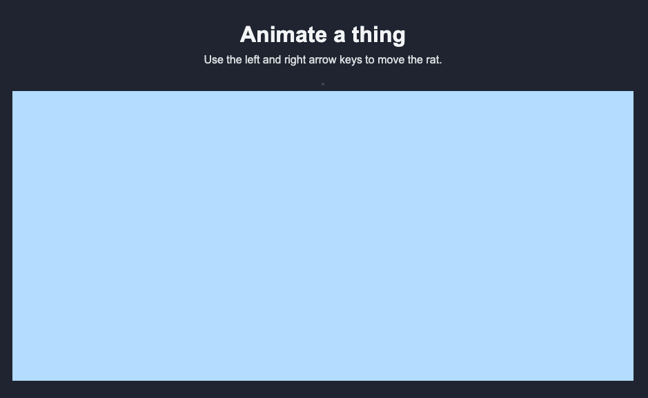

## Set up your sketch

In this section, you will get your sketch ready to use. You will create the canvas where your game will appear, and then add a background colour so you can check that everything is working.

### Step 1

Start by setting up the canvas in `setup()`. This makes a space for your sketch, tells p5.js to draw images from their centre, and puts the rat in the middle of the screen.

--- code ---
---
language: javascript
filename: sketch.js
line_numbers: true
line_number_start: 15
line_highlights: 16-19
---
function setup() {
  createCanvas(900, 420);
  imageMode(CENTER);
  noSmooth();
  ratX = width / 2;
}
--- /code ---

### Step 2

Now add a background colour inside `draw()`. This will paint the canvas every frame.

--- code ---
---
language: javascript
filename: sketch.js
line_numbers: true
line_number_start: 22
line_highlights: 23
---
function draw() {
  background(180, 220, 255);
}
--- /code ---

### Now run your code

Your sketch should show a light blue rectangle.

### Tip
{: .c-project-callout .c-project-callout--tip}
- Try changing the three numbers in `background(180, 220, 255)` to make a different colour.
- Change `createCanvas(900, 420)` to make your sketch wider or taller.

### Debugging
{: .c-project-callout .c-project-callout--debug}
- Make sure `createCanvas(...)` is inside `setup()`, not inside `draw()`.
- `CENTER` must be written in capital letters.