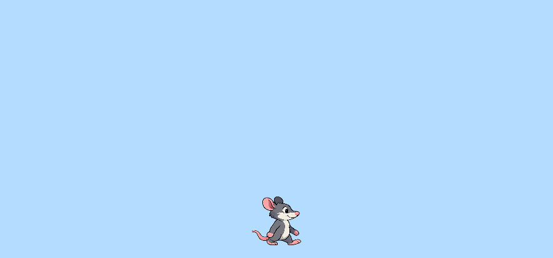

## Put the rat on the screen

In this section, you will load the rat pictures and draw the rat on the canvas. You will start by loading the animation frames, then draw one frame, and finally choose where the rat should stand.

### Step 1

Add this code to `preload()` to load all six rat images before the sketch starts.

--- code ---
---
language: javascript
filename: sketch.js
line_numbers: true
line_number_start: 12
line_highlights: 13-15
---
function preload() {
  for (let frameNumber = 0; frameNumber < 6; frameNumber += 1) {
    ratFrames.push(loadImage(`rat_${frameNumber}.png`));
  }
}
--- /code ---

### Step 2

Now add this line to `drawRat(x, y)` to draw the first rat image.

--- code ---
---
language: javascript
filename: sketch.js
line_numbers: true
line_number_start: 29
line_highlights: 30
---
function drawRat(x, y) {
  image(ratFrames[0], x, y, ratWidth, ratHeight);
}
--- /code ---

### Step 3

Finally, go back to `draw()` and choose a `y` position for the rat. Then call `drawRat()` to show it on the screen.

--- code ---
---
language: javascript
filename: sketch.js
line_numbers: true
line_number_start: 25
line_highlights: 28-29
---
function draw() {
  background(180, 220, 255);

  let ratY = height - ratHeight / 2 - 20;
  drawRat(ratX, ratY);
}
--- /code ---

### Now run your code

Your sketch should show the rat standing near the bottom of the blue canvas.

### Tip
{: .c-project-callout .c-project-callout--tip}
- Change `-20` to a different number to move the rat up or down.
- Try changing `ratWidth` and `ratHeight` at the top of your code to make the rat bigger or smaller.

### Debugging
{: .c-project-callout .c-project-callout--debug}
- Check that your image files are called `rat_0.png` to `rat_5.png`.
- Make sure you used backticks in `` `rat_${frameNumber}.png` ``.
- Check that `drawRat(ratX, ratY);` is inside `draw()`.