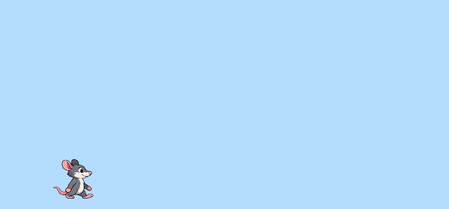

## Make the rat move

In this section, you will use the keyboard to move the rat left and right. You will add the code inside `draw()` so the sketch can check the arrow keys again and again.

Add two `if` statements inside `draw()`. One checks whether the left arrow key is pressed, and the other checks for the right arrow key.

--- code ---
---
language: javascript
filename: sketch.js
line_numbers: true
line_number_start: 25
line_highlights: 28-33
---
function draw() {
  background(180, 220, 255);

  if (keyIsDown(LEFT_ARROW)) {
    ratX -= moveSpeed;
  }
  if (keyIsDown(RIGHT_ARROW)) {
    ratX += moveSpeed;
  }

  let ratY = height - ratHeight / 2 - 20;
  drawRat(ratX, ratY);
}
--- /code ---

### Now run your code

Press the left and right arrow keys. The rat should move across the screen.

### Tip
{: .c-project-callout .c-project-callout--tip}
- Change `moveSpeed` at the top of your code to make the rat move faster or slower.
- Try a very small number like `1`, then a bigger number like `10`, and compare what happens.

### Debugging
{: .c-project-callout .c-project-callout--debug}
- Make sure the movement code is inside `draw()`, not inside `setup()`.
- Check that you typed `LEFT_ARROW` and `RIGHT_ARROW` exactly, with capital letters.
- If the rat is not moving, make sure you changed `ratX` and not `ratY`.