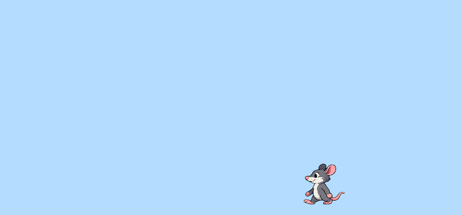

## Make the rat face the right way

In this section, you will use the `facingLeft` variable to remember which way the rat is moving. Then you will flip the rat image so it looks left when it walks left.

### Step 1

First, update the movement code in `draw()` so the sketch remembers the rat's direction.

--- code ---
---
language: javascript
filename: sketch.js
line_numbers: true
line_number_start: 23
line_highlights: 27,31
---
function draw() {
  background(180, 220, 255);

  if (keyIsDown(LEFT_ARROW)) {
    ratX -= moveSpeed;
    facingLeft = true;
  }
  if (keyIsDown(RIGHT_ARROW)) {
    ratX += moveSpeed;
    facingLeft = false;
  }

  let ratY = height - ratHeight / 2 - 20;
  drawRat(ratX, ratY);
}
--- /code ---

### Step 2

Now replace `drawRat()` with this new version. It uses `translate(x, y)` to move the drawing point, so the image must be drawn at `0, 0`.

--- code ---
---
language: javascript
filename: sketch.js
line_numbers: true
line_number_start: 41
line_highlights: 42-48
---
function drawRat(x, y) {
  push(); // Only the rat
  translate(x, y);
  if (facingLeft) {
    scale(-1, 1); // flip on the horizontal
  }
  image(ratFrames[0], 0, 0, ratWidth, ratHeight);
  pop();
}
--- /code ---

### Now run your code

Press the left and right arrow keys. The rat should turn to face the direction it is moving.

### Tip
{: .c-project-callout .c-project-callout--tip}
- `translate(x, y)` moves the drawing point before the image is drawn.
- After using `translate(x, y)`, draw the image at `0, 0`.

### Debugging
{: .c-project-callout .c-project-callout--debug}
- Make sure you changed the `image(...)` line to use `0, 0`, not `x, y`.
- Check that `push()` and `pop()` are both included.
- If the rat disappears, check that `scale(-1, 1)` is inside the `if (facingLeft)` block.