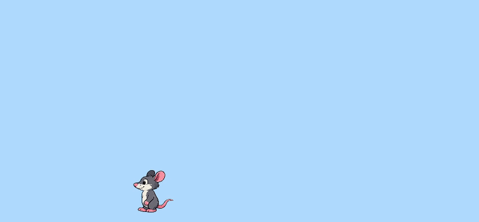

## Animate the rat

In this section, you will use the rat animation frames you loaded earlier. You will draw the current frame, update the frame number, and then slow the animation down so the rat does not move too fast.

### Step 1

First, change `drawRat()` so it draws the current frame number instead of always drawing the first picture.

--- code ---
---
language: javascript
filename: sketch.js
line_numbers: true
line_number_start: 41
line_highlights: 47
---
function drawRat(x, y) {
  push(); // Only the rat
  translate(x, y);
  if (facingLeft) {
    scale(-1, 1); // flip on the horizontal
  }
  image(ratFrames[frameIndex], 0, 0, ratWidth, ratHeight);
  pop();
}
--- /code ---

### Step 2

Now add code to `advanceWalkCycle()` to move to the next frame. If the frame number gets too big, set it back to `0`.

--- code ---
---
language: javascript
filename: sketch.js
line_numbers: true
line_number_start: 51
line_highlights: 52-55
---
function advanceWalkCycle() {
  frameIndex += 1;
  if (frameIndex >= ratFrames.length) {
    frameIndex = 0;
  }
}
--- /code ---

### Step 3

Finally, call `advanceWalkCycle()` inside `draw()`. Use `animationDelay` to slow the animation down.

--- code ---
---
language: javascript
filename: sketch.js
line_numbers: true
line_number_start: 25
line_highlights: 37-39
---
function draw() {
  background(180, 220, 255);

  if (keyIsDown(LEFT_ARROW)) {
    ratX -= moveSpeed;
    facingLeft = true;
  }
  if (keyIsDown(RIGHT_ARROW)) {
    ratX += moveSpeed;
    facingLeft = false;
  }

  if (frameCount % animationDelay === 0) {
    advanceWalkCycle();
  }

  let ratY = height - ratHeight / 2 - 20;
  drawRat(ratX, ratY);
}
--- /code ---

### Now run your code

Your rat should now cycle through its animation frames.

### Tip
{: .c-project-callout .c-project-callout--tip}
- Try changing `animationDelay` at the top of your code. Smaller numbers make the animation faster.
- `frameCount` is a p5.js variable that counts how many times `draw()` has run.

### Debugging
{: .c-project-callout .c-project-callout--debug}
- Make sure you changed `ratFrames[0]` to `ratFrames[frameIndex]`.
- Check that `frameIndex = 0;` is inside the `if` block in `advanceWalkCycle()`.
- If the rat disappears, check that you typed `ratFrames.length` correctly.