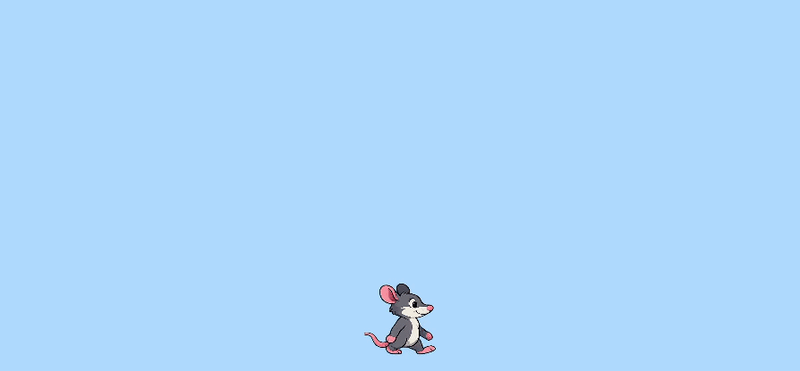

## Only animate the rat when it moves

Right now, the rat keeps walking all the time. In this section, you will make the rat animate only when the player presses an arrow key.

### Step 1

Start by adding a new variable called `isMoving` inside `draw()`. Set it to `true` when the left or right arrow key is pressed.

--- code ---
---
language: javascript
filename: sketch.js
line_numbers: true
line_number_start: 25
line_highlights: 28, 33, 38
---
function draw() {
  background(180, 220, 255);

  let isMoving = false;

  if (keyIsDown(LEFT_ARROW)) {
    ratX -= moveSpeed;
    facingLeft = true;
    isMoving = true;
  }
  if (keyIsDown(RIGHT_ARROW)) {
    ratX += moveSpeed;
    facingLeft = false;
    isMoving = true;
  }

  if (frameCount % animationDelay === 0) {
    advanceWalkCycle();
  }

  let ratY = height - ratHeight / 2 - 20;
  drawRat(ratX, ratY);
}
--- /code ---

### Step 2

Now update the animation code so `advanceWalkCycle()` only runs when `isMoving` is `true`.

--- code ---
---
language: javascript
filename: sketch.js
line_numbers: true
line_number_start: 25
line_highlights: 41
---
function draw() {
  background(180, 220, 255);

  let isMoving = false;

  if (keyIsDown(LEFT_ARROW)) {
    ratX -= moveSpeed;
    facingLeft = true;
    isMoving = true;
  }
  if (keyIsDown(RIGHT_ARROW)) {
    ratX += moveSpeed;
    facingLeft = false;
    isMoving = true;
  }

  if (isMoving && frameCount % animationDelay === 0) {
    advanceWalkCycle();
  }

  let ratY = height - ratHeight / 2 - 20;
  drawRat(ratX, ratY);
}
--- /code ---

### Now run your code

Press the left and right arrow keys to move the rat. When you stop pressing the keys, the rat should stop walking.

### Tip
{: .c-project-callout .c-project-callout--tip}
- `isMoving` starts as `false` every time `draw()` runs.
- It only changes to `true` when one of the arrow keys is pressed.

### Debugging
{: .c-project-callout .c-project-callout--debug}
- Make sure `let isMoving = false;` is inside `draw()`.
- Check that both movement `if` statements include `isMoving = true;`.
- Make sure you changed the animation `if` statement to use `isMoving &&`.